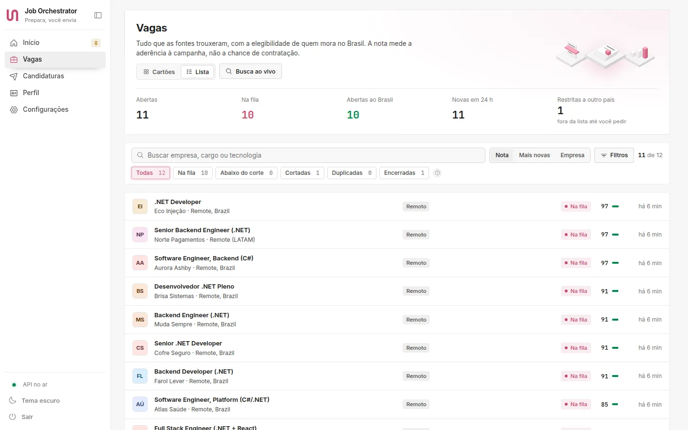
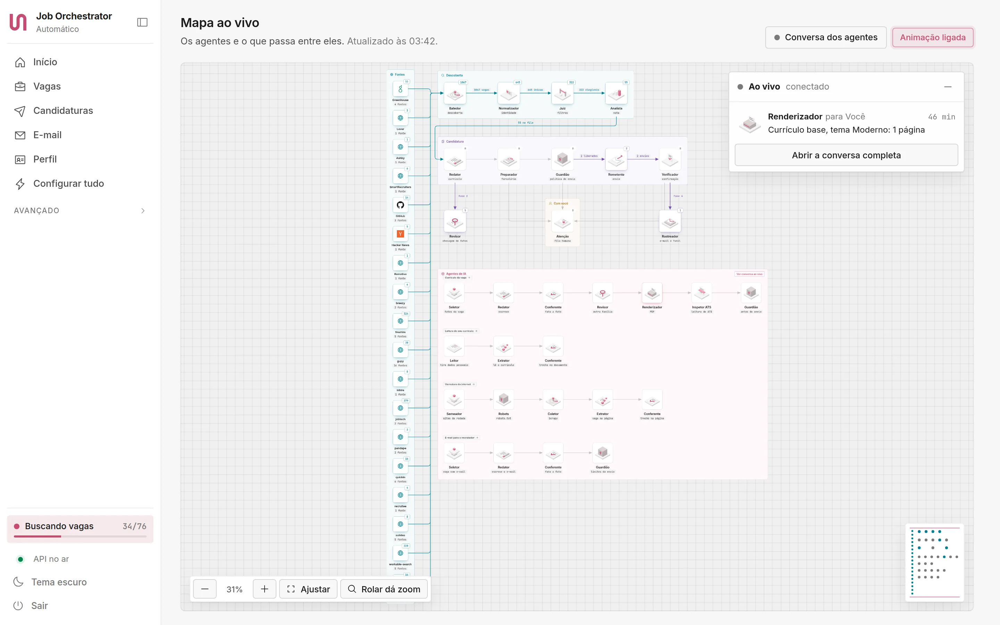
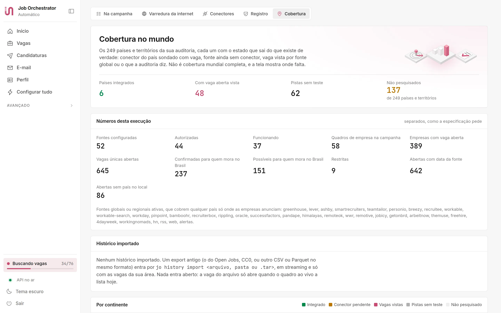
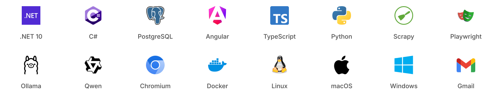

<p align="center">
  <picture>
    <source media="(prefers-color-scheme: dark)" srcset=".github/assets/banner-en-dark.svg">
    
  </picture>
</p>

<p align="center">
  <a href="https://gabrielandre-math.github.io/job-orchestrator/"><b>Website</b></a> &nbsp;|&nbsp;
  <a href="#download"><b>Download</b></a> &nbsp;|&nbsp;
  <a href="#how-it-works">How it works</a> &nbsp;|&nbsp;
  <a href="#self-hosted-by-design">Self-hosted</a> &nbsp;|&nbsp;
  <a href="#coming-soon-job-orchestrator-for-recruiters">For recruiters (soon)</a> &nbsp;|&nbsp;
  <a href="#build-from-source">Build from source</a> &nbsp;|&nbsp;
  <a href="README.pt-BR.md">Português</a>
</p>

<p align="center">
  <a href="https://github.com/gabrielandre-math/job-orchestrator/releases/latest"></a>
  
  
  <a href="LICENSE.md"></a>
</p>

Job Orchestrator runs your job search on your own computer. It reads job boards and company career pages, keeps the openings you are actually allowed to apply to, scores each one against your CV with a language model on your GPU, writes a résumé for every job using only facts from your own documents, and fills in the application when you approve it.

There is no Job Orchestrator account, server or subscription. You install it like any desktop app, and it keeps everything in your user folder.

<p align="center">
  <picture>
    <source media="(prefers-color-scheme: dark)" srcset=".github/assets/screen-jobs-dark.webp">
    
  </picture>
</p>

The interface is in Brazilian Portuguese. Résumés and form answers are written in Portuguese for jobs in Brazil and in English everywhere else.

## Self-hosted by design

- **Everything runs on your machine.** The app, its database (a private PostgreSQL that the installer downloads, about 60 MB, no Docker needed), the browser automation, the scraper and the AI model. The panel only listens on `127.0.0.1:7410`.
- **Your data stays in your user folder.** CV, profile, résumés, application history and e-mail metadata live in `~/.local/share/job-orchestrator` on Linux, `~/Library/Application Support/JobOrchestrator` on macOS and `%LOCALAPPDATA%\JobOrchestrator` on Windows. What leaves the computer is what a source needs to answer a request and the applications you approve.
- **No telemetry.** Nothing reports usage anywhere.
- **The local model comes first.** Reading CVs, scoring jobs and drafting text run on a model served by [Ollama](https://ollama.com). It uses your GPU when Ollama supports it (NVIDIA, AMD or Apple Silicon) and the CPU otherwise. The Providers screen installs the model for you.
- **Your own AI subscription is optional.** If you already use Claude Code or the Codex CLI, the app can call them for the heavier writing, in the order you choose and with a reserve, so the quota you need for your own work stays untouched. No paid API key is required.

## How it works

<table>
  <tr>
    <td width="112" align="center"><picture><source media="(prefers-color-scheme: dark)" srcset=".github/assets/step-radar-dark.svg"></picture></td>
    <td><b>1. Find.</b> The Scout checks 52 registered sources through their official APIs or public pages: company career sites on Greenhouse, Lever, Ashby, SmartRecruiters, Workday, Workable and Teamtailor, Brazilian platforms such as Gupy, Sólides, InHire, Quickin and Pandapé, job APIs like Himalayas, Remotive, Remote OK and Get on Board, public employment services in Sweden, Norway, Czechia, Latvia and the United States, Hacker News and GitHub hiring threads, and the job alerts that land in your inbox. Every 10 minutes the Explorer looks for new sources based on your CV and keeps the ones that bring jobs you have not seen.</td>
  </tr>
  <tr>
    <td align="center"><picture><source media="(prefers-color-scheme: dark)" srcset=".github/assets/step-chart-dark.svg"></picture></td>
    <td><b>2. Sort.</b> Duplicates across boards collapse into one job. Openings restricted to a country where you cannot work leave the queue. Each remaining job gets a score from 0 to 100 with the reasons spelled out, and the ones above your cut line move on. The score measures fit with your search, not your chances of being hired.</td>
  </tr>
  <tr>
    <td align="center"><picture><source media="(prefers-color-scheme: dark)" srcset=".github/assets/step-writer-dark.svg"></picture></td>
    <td><b>3. Write.</b> The Writer builds a résumé for each job using only facts found in your CV, your LinkedIn export and your profile. A checker compares every line with its source, a reviewer from a different model family reads it again, and an ATS inspector parses the final PDF the way an applicant tracking system would. A cover letter is optional and follows the language of the job.</td>
  </tr>
  <tr>
    <td align="center"><picture><source media="(prefers-color-scheme: dark)" srcset=".github/assets/step-guardian-dark.svg"></picture></td>
    <td><b>4. Apply, with your OK.</b> The form is filled in a real browser, and you can run a rehearsal that stops before the submit button. Nothing goes out without your approval or an authorization you set up for that kind of job, always within a daily cap and a time window. CAPTCHAs and logins are handed to you.</td>
  </tr>
  <tr>
    <td align="center"><picture><source media="(prefers-color-scheme: dark)" srcset=".github/assets/step-inbox-dark.svg"></picture></td>
    <td><b>5. Follow up.</b> With read-only access to Gmail, replies move each application along the funnel. Every application keeps an append-only history and a proof of submission.</td>
  </tr>
</table>

Job Orchestrator applies to jobs in your name. Read what it prepares before you let it send anything on its own.

## Plays by the rules

- LinkedIn is never automated, because its terms forbid it. Import your LinkedIn data export to fill in your profile, and save LinkedIn jobs by link to keep track of the ones you apply to yourself.
- CAPTCHAs on external sites are left to the user. When a site blocks automated access, that source is skipped.
- The scraper follows robots.txt, waits between requests and opens one connection per site.
- Sources whose terms do not allow this kind of use stay in the registry as blocked (LinkedIn Jobs, France Travail) or partner-only (the Gupy employer API and Singapore's MyCareersFuture), so you can see why they are off.

Of the 52 registered sources, 24 are stable, 20 are experimental, 4 need a free API key of your own, 2 are partner-only and 2 are blocked. The catalog behind the Scout lists 34,880 company job boards.

## A closer look

<picture>
  <source media="(prefers-color-scheme: dark)" srcset=".github/assets/screen-live-map-dark.webp">
  
</picture>

**Live map.** Every agent and what passes between them, updated while the search runs.

<picture>
  <source media="(prefers-color-scheme: dark)" srcset=".github/assets/screen-coverage-dark.webp">
  
</picture>

**Coverage.** For 249 countries and territories: where a source works, where openings show up through global boards, and where nothing has been checked yet.

## Coming soon: Job Orchestrator for recruiters

> [!NOTE]
> In design for a future version. None of this is in the current release, and the details may change before it ships.

<picture>
  <source media="(prefers-color-scheme: dark)" srcset=".github/assets/recruiters-en-dark.svg">
  
</picture>

Today Job Orchestrator works for the person looking for a job. The next step is the other side of the table: recruiters publishing jobs straight on the platform and using the people registered on it as their talent base, under the same rules. That base will not be a database someone collected. Each person will decide whether to be found, by which companies and with how much detail, and the profile will stay on their own computer until they share it.

**How it will work**

<table>
  <tr>
    <td width="112" align="center"><picture><source media="(prefers-color-scheme: dark)" srcset=".github/assets/step-form-dark.svg"></picture></td>
    <td><b>Direct jobs.</b> Recruiters will describe the job in a few lines or in a short voice note transcribed on their own machine. The posting writer will turn it into a structured job, and a checker will flag what Brazilian law forbids in job ads (references to sex, age, color or family situation, CLT article 373-A), wording that pushes people away, requirements the job does not need and a missing salary range, while affirmative jobs stay possible. Each job will be published on the company's own domain as schema.org JobPosting and verified through DNS, so Google for Jobs can list it, and every candidate's Scout will read it as a native source, with no scraping, no form filling and no CAPTCHA.</td>
  </tr>
  <tr>
    <td align="center"><picture><source media="(prefers-color-scheme: dark)" srcset=".github/assets/step-router-dark.svg"></picture></td>
    <td><b>One call, thousands of GPUs.</b> To reach people, the recruiter will send a call: the job and its requirements, with no question about anyone in particular. Each Job Orchestrator will pull the calls of the companies it follows every few minutes and score them against its owner's profile with the local model. Ten thousand candidates will mean ten thousand machines doing their own screening, and no central database to leak, sell or train on.</td>
  </tr>
  <tr>
    <td align="center"><picture><source media="(prefers-color-scheme: dark)" srcset=".github/assets/step-queue-dark.svg"></picture></td>
    <td><b>A talent base people choose to join.</b> Everyone registered on Job Orchestrator will be able to turn on "open to offers" and choose which companies see them and how much: an anonymous card with skills, seniority, work model and salary floor, or the full résumé with evidence. Their machine will send the card to those companies and keep it current while the option is on. Recruiters will search this base in plain language with the local model, for example "senior .NET backend, remote from Brazil, AWS in production", see evidence instead of names and send invitations. Name and contact will appear only after the person accepts, and turning the option off will remove the card everywhere.</td>
  </tr>
  <tr>
    <td align="center"><picture><source media="(prefers-color-scheme: dark)" srcset=".github/assets/step-identity-dark.svg"></picture></td>
    <td><b>Yes, by choice.</b> The candidate's own rules will decide what reaches them: salary floor, work model, company size and how often. A good match will show up as a suggestion, and nothing will leave the machine until they say yes. Only then will the recruiter receive a résumé encrypted to them. A no, or a call that never matched, will leave no trace on the recruiter's side, not even a "seen".</td>
  </tr>
  <tr>
    <td align="center"><picture><source media="(prefers-color-scheme: dark)" srcset=".github/assets/step-gate-dark.svg"></picture></td>
    <td><b>Evidence, not a score.</b> Every line of a shared résumé will link to the document it came from, which is how Job Orchestrator already builds résumés today. Recruiters will review the evidence requirement by requirement, first in blind mode, with name, photo, age, address and school hidden. Nobody will be ranked by a single opaque number, a person will make every rejection, and the candidate will be able to ask for a review, as LGPD article 20 allows.</td>
  </tr>
  <tr>
    <td align="center"><picture><source media="(prefers-color-scheme: dark)" srcset=".github/assets/step-you-dark.svg"></picture></td>
    <td><b>Agents that talk in the open.</b> The two Job Orchestrators will handle the back and forth. They will find an interview time without exposing either calendar, answer standard questions from the candidate's saved answers and share the salary expectation only when the job publishes a range. Every message will show up live on both screens, like the agent chat on today's live map, and stay in the history.</td>
  </tr>
  <tr>
    <td align="center"><picture><source media="(prefers-color-scheme: dark)" srcset=".github/assets/step-receipt-dark.svg"></picture></td>
    <td><b>A receipt and an answer for everyone.</b> Applications, status changes and decisions will come with signed receipts. Each company will set an answer deadline, and an application still unanswered by then will close as such and count toward the company's response rate, which candidates will see before they apply. A rejection will name the requirement that was missing, so feedback replaces silence and feeds the candidate's job gaps.</td>
  </tr>
  <tr>
    <td align="center"><picture><source media="(prefers-color-scheme: dark)" srcset=".github/assets/step-guardian-dark.svg"></picture></td>
    <td><b>Consent with an end date.</b> Talent pools will keep people only with consent that expires. Candidates will see which companies hold their data and until when, and one click will revoke it. The company's instance will delete the data and return a signed deletion receipt, so the LGPD rights to access, correct, delete and port data become messages of the protocol.</td>
  </tr>
</table>

**The AI machine on both sides**

- **Same engine.** Local models through Ollama will come first, a fast one for screening and a stronger one for writing. Claude Code and Codex will stay optional, the reviewer will always come from another model family, and each task will start on the smallest model that passes validation.
- **Matching where the data lives.** The embeddings of a candidate's evidence will never leave their machine. Each machine will embed the call once and score it on its own GPU, so recruiters will not need a GPU farm to screen a crowd. Searching the talent base will run on the recruiter's local model, over the cards people chose to send.
- **Counts that protect people.** Before publishing, a requirement thermometer will estimate how many people match each requirement, using opt-in counts with differential privacy noise, so no one can be singled out. It will show things like "dropping fluent English roughly doubles the pool".
- **An open protocol.** Jobs, calls, answers and receipts will be signed JSON over HTTPS, with Ed25519 signatures and end-to-end encryption to the recipient, discovered through `/.well-known/` on the company's domain. Candidate machines will only pull, so they never open a port.
- **One app, two modes.** The same binary will get a company mode for the hiring team, with recruiter, hiring manager and interviewer roles, self-hosted on a laptop or on a company server.

**More ideas on the list**

- An honest salary range, checked against open jobs that publish pay for the same role and level.
- A ghost job guard: jobs not renewed every 30 days will expire on every candidate's screen.
- The scam sentinel on calls: fees, crypto payments or a move to WhatsApp will keep a call from reaching anyone.
- Interview practice with the candidate's local model, based on the competencies the job publishes.
- Offers side by side, with net pay under CLT and PJ compared when an offer arrives.
- Structured interviews, with the same questions for every candidate and a scorecard per requirement.
- A market radar for recruiters, with scarce skills and pay bands from the public jobs Job Orchestrator already reads.

**Lines it will not cross**

- No profiles scraped from LinkedIn or anywhere else to fill a base.
- No selling or sharing of candidates' data, and no training on it.
- No ranking of people by one opaque score, and no automatic rejections.
- No emotion, voice or face analysis in interviews. The EU AI Act already bans emotion recognition at work.
- No contact outside a real job with a published salary range, and the candidate decides how often anything reaches them.

Hiring with the recruiter side will be commercial use, so companies will need a commercial license from the author. People and nonprofits keep using Job Orchestrator for free.

## Download

Each download is a single self-contained executable with the panel, the scraper and the browser extension inside. You do not need .NET installed.

**Install with one command (recommended)**

macOS and Linux:

```sh
curl -fsSL https://gabrielandre-math.github.io/job-orchestrator/install.sh | sh
```

Windows (PowerShell):

```powershell
irm https://gabrielandre-math.github.io/job-orchestrator/install.ps1 | iex
```

The command downloads the file for your system from the latest release, checks its SHA-256 against `SHA256SUMS.txt` and opens the app's installer. A file fetched this way is not marked as downloaded from the internet, so macOS and Windows open it without the warning they show for apps without a paid signature. Read the scripts first if you like: [`site/install.sh`](site/install.sh) and [`site/install.ps1`](site/install.ps1).

**Or download the file**

| System | Download | Notes |
| --- | --- | --- |
| **Linux** x64 | [Installer (.run)](https://github.com/gabrielandre-math/job-orchestrator/releases/latest/download/job-orchestrator-linux-x64.run) &nbsp; [Archive (.tar.gz)](https://github.com/gabrielandre-math/job-orchestrator/releases/latest/download/job-orchestrator-linux-x64.tar.gz) | `chmod +x` the installer and run it. No sudo. |
| **Linux** arm64 | [Installer (.run)](https://github.com/gabrielandre-math/job-orchestrator/releases/latest/download/job-orchestrator-linux-arm64.run) &nbsp; [Archive (.tar.gz)](https://github.com/gabrielandre-math/job-orchestrator/releases/latest/download/job-orchestrator-linux-arm64.tar.gz) | |
| **macOS** Apple Silicon | [Disk image (.dmg)](https://github.com/gabrielandre-math/job-orchestrator/releases/latest/download/job-orchestrator-macos-arm64.dmg) | macOS 15 or later. |
| **macOS** Intel | [Disk image (.dmg)](https://github.com/gabrielandre-math/job-orchestrator/releases/latest/download/job-orchestrator-macos-x64.dmg) | macOS 15 or later. |
| **Windows** x64 | [Setup (.exe)](https://github.com/gabrielandre-math/job-orchestrator/releases/latest/download/job-orchestrator-windows-x64-setup.exe) &nbsp; [Archive (.zip)](https://github.com/gabrielandre-math/job-orchestrator/releases/latest/download/job-orchestrator-windows-x64.zip) | |
| **Windows** arm64 | [Setup (.exe)](https://github.com/gabrielandre-math/job-orchestrator/releases/latest/download/job-orchestrator-windows-arm64-setup.exe) &nbsp; [Archive (.zip)](https://github.com/gabrielandre-math/job-orchestrator/releases/latest/download/job-orchestrator-windows-arm64.zip) | Experimental. |

Every file has its SHA-256 in [SHA256SUMS.txt](https://github.com/gabrielandre-math/job-orchestrator/releases/latest/download/SHA256SUMS.txt).

The builds are not signed with a paid certificate yet, so a file downloaded in the browser takes one extra step on first launch:

- **macOS:** the app is signed ad hoc. If macOS refuses to open it, go to System Settings, then Privacy & Security, and click Open Anyway. Or run `xattr -dr com.apple.quarantine "/Applications/Job Orchestrator.app"`.
- **Windows:** SmartScreen shows "Windows protected your PC". Click More info, then Run anyway.

## First run

1. Run the installer. It checks the machine (browser, database, scraper, local model, GPU, disk space and keyring), copies the app to your user folder, starts its own PostgreSQL, prepares the scraper with a Python of its own and adds a menu entry. It never asks for an administrator password, and anything missing turns into a command or a link for you.
2. When the app opens, a short setup asks you to connect an AI (the local model, your CLI or both), upload your CV as a PDF and confirm one screen with what it could not infer: work authorization, salary floor, work model, start date and English level. Connecting Gmail is optional.
3. On the home screen, **Automatizar tudo** (automate everything) turns on the search schedule, the Explorer, the sending mode and e-mail in one pass. If you prefer, stay in review mode and approve each application yourself.

```sh
job-orchestrator               # opens the app; the first time, the installer
job-orchestrator --status      # shows whether it is running
job-orchestrator --stop        # stops the services
job-orchestrator --backup      # copies the database now
job-orchestrator --restore ZIP # restores the database from a backup
job-orchestrator --mcp         # MCP server for Claude Code and Claude Desktop
job-orchestrator --uninstall   # removes the app and keeps your data (--purge removes it too)
```

## Under the hood

<picture>
  <source media="(prefers-color-scheme: dark)" srcset=".github/assets/stack-dark.svg">
  
</picture>

- **Backend:** .NET 10, a modular monolith split into vertical slices with DDD and CQRS, an outbox and an inbox for events, Carter endpoints and Dapper over PostgreSQL. A worker process runs the schedules, the Explorer and the e-mail sync.
- **Panel:** Angular 22 with signals. The live map is a hand-drawn SVG canvas, and the isometric icons are drawn in code from one shared geometry.
- **Collection:** official APIs first, Scrapy spiders for career pages (robots.txt, AutoThrottle, JSON-LD JobPosting) and a Playwright browser pool for pages that need JavaScript and for filling in forms.
- **AI:** local models through Ollama, with Claude Code and Codex as optional providers. Each task starts on the smallest model that passes validation and only moves up when the output fails, and the reviewer never comes from the same model family as the writer.
- **Packaging:** one self-contained binary per platform, an installer for each system and a built-in MCP server.
- **Tests:** unit and end-to-end suites against a fake ATS with 10 scenarios, plus chaos tests that kill the process right before and right after the submit click and check that the application ends up sent exactly once or handed back to you.

More detail, in Portuguese: [user guide](docs/guia.md), [architecture](docs/architecture.md), [operations runbook](docs/runbook.md) and [threat model](docs/threat-model.md).

## Build from source

You need the .NET 10 SDK, Node.js 22 or newer, Python 3.11 or newer and Docker for the development database.

```sh
git clone https://github.com/gabrielandre-math/job-orchestrator.git
cd job-orchestrator
scripts/dev.sh                    # PostgreSQL in Docker, the fake ATS, API and worker; data in .dev/
docker compose -f infra/compose.test.yaml up -d --wait
dotnet test backend/tests/JobOrchestrator.Tests --filter "Category!=E2E"
scripts/package.sh all            # the six platform builds, in dist/
```

### Local CAPTCHA and jobs labs

The Fake ATS includes image and arithmetic CAPTCHA challenges and a paginated job feed. The job router reads JSON-LD and HTML cards, deduplicates listings and can also process local HTML files. See the [lab guide and test commands](docs/labs.md).

## License

Job Orchestrator is source-available under the [PolyForm Noncommercial License 1.0.0](LICENSE.md). You can use it, study it, change it and share it for any noncommercial purpose, and that includes running your own job search. Selling it, offering it as a paid service or building it into a commercial product is not allowed. If you want to use it commercially, talk to the author first.

## Author

Made by **Gabriel André de Lima Silva** ([@gabrielandre-math](https://github.com/gabrielandre-math)). Bug reports and ideas are welcome in the [issues](https://github.com/gabrielandre-math/job-orchestrator/issues).

The mark is shape 57 from [shapes.gallery](https://www.shapes.gallery/) by Monika Michalczyk, used as published. Brand logos belong to their owners. The release binaries carry the licenses of the runtime and libraries they bundle.
