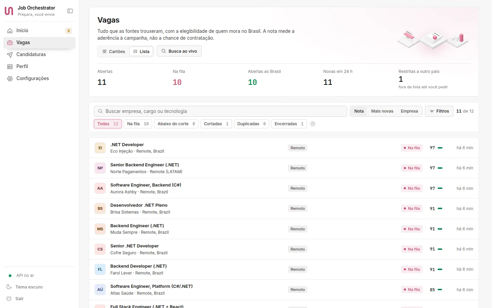
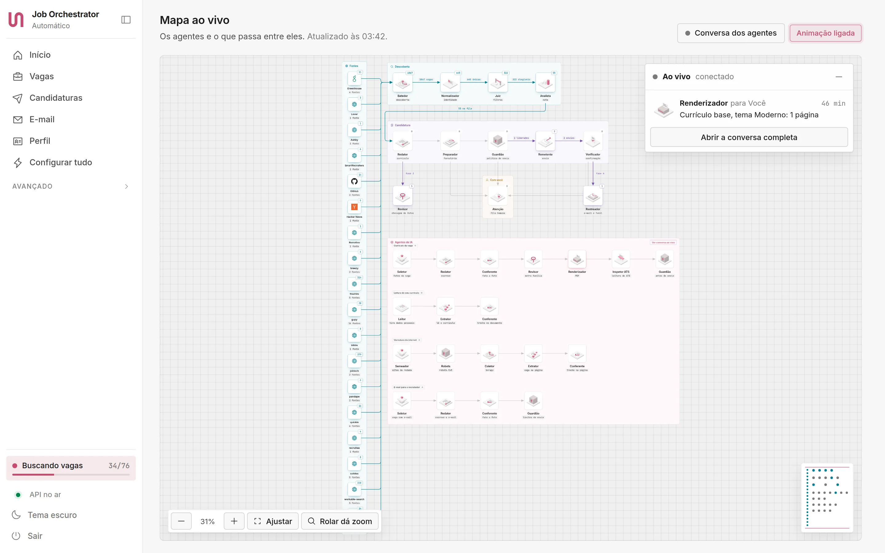
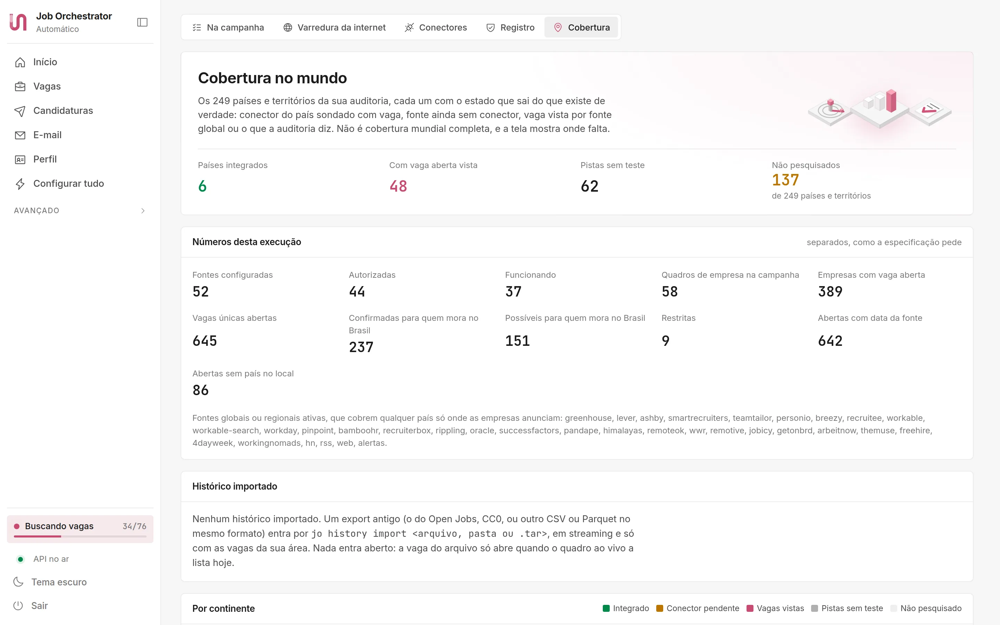
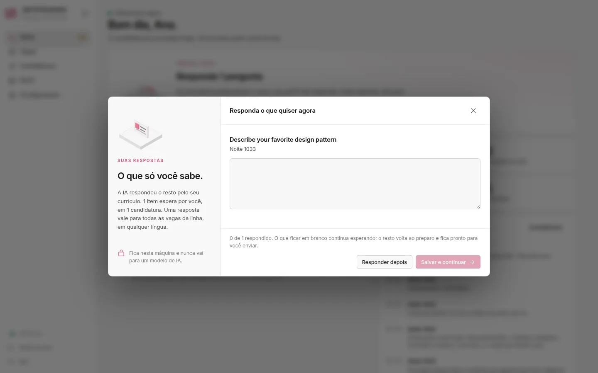
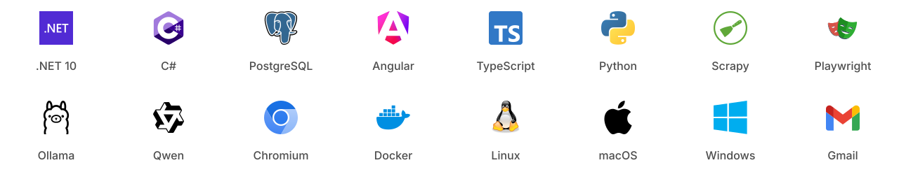

<p align="center">
  <picture>
    <source media="(prefers-color-scheme: dark)" srcset=".github/assets/banner-pt-dark.svg">
    
  </picture>
</p>

<p align="center">
  <a href="https://gabrielandre-math.github.io/job-orchestrator/"><b>Site</b></a> &nbsp;|&nbsp;
  <a href="#download"><b>Download</b></a> &nbsp;|&nbsp;
  <a href="#como-funciona">Como funciona</a> &nbsp;|&nbsp;
  <a href="#self-hosted-de-verdade">Self-hosted</a> &nbsp;|&nbsp;
  <a href="#em-breve-o-job-orchestrator-para-recrutadores">Para recrutadores (em breve)</a> &nbsp;|&nbsp;
  <a href="#compilar-a-partir-do-código">Compilar</a> &nbsp;|&nbsp;
  <a href="README.md">English</a>
</p>

<p align="center">
  <a href="https://github.com/gabrielandre-math/job-orchestrator/releases/latest"></a>
  
  
  <a href="LICENSE.md"></a>
</p>

O Job Orchestrator faz a sua busca de emprego no seu próprio computador. Ele lê quadros de vagas e páginas de carreira das empresas, separa as vagas em que você pode mesmo se candidatar, dá a cada uma uma nota contra o seu currículo com um modelo de linguagem rodando na sua GPU, escreve um currículo para cada vaga só com fatos dos seus documentos e preenche a candidatura quando você aprova.

Não existe conta, servidor nem assinatura do Job Orchestrator. A instalação é a de qualquer app de desktop, e tudo fica na sua pasta de usuário.

<p align="center">
  <picture>
    <source media="(prefers-color-scheme: dark)" srcset=".github/assets/screen-jobs-dark.webp">
    
  </picture>
</p>

A interface é em português do Brasil. Currículos e respostas de formulário saem em português para vagas no Brasil e em inglês para as demais.

## Self-hosted de verdade

- **Tudo roda na sua máquina.** O app, o banco (um PostgreSQL próprio que o instalador baixa, com uns 60 MB, sem Docker), a automação do navegador, o coletor e o modelo de IA. O painel só atende em `127.0.0.1:7410`.
- **Os seus dados ficam na sua pasta de usuário.** Currículo, perfil, currículos gerados, histórico das candidaturas e dados dos e-mails ficam em `~/.local/share/job-orchestrator` no Linux, em `~/Library/Application Support/JobOrchestrator` no macOS e em `%LOCALAPPDATA%\JobOrchestrator` no Windows. Sai do computador apenas o que uma fonte precisa para responder e as candidaturas que você aprova.
- **Sem telemetria.** Nada informa uso para lugar nenhum.
- **O modelo local vem primeiro.** Ler currículo, dar nota às vagas e escrever textos fica com um modelo servido pelo [Ollama](https://ollama.com). Ele usa a sua GPU quando o Ollama tem suporte a ela (NVIDIA, AMD ou Apple Silicon) e o processador nos outros casos. A tela de Provedores instala o modelo para você.
- **Um rastro para diagnóstico, no seu disco.** Requisições que mudam algo, cada passo da fila, cada mudança de estado, as chamadas de IA e os erros da tela vão para um log local guardado por 14 dias, que a tela Diagnóstico filtra. Nenhuma resposta, currículo ou corpo de e-mail entra nele, e ele nunca é enviado a lugar nenhum.
- **A sua assinatura de IA é opcional.** Se você já usa o Claude Code ou o Codex CLI, o app pode chamá-los para os textos mais pesados, na ordem que você escolher e com uma reserva, para a cota do seu trabalho continuar intacta. Nenhuma chave de API paga é necessária.

## Como funciona

<table>
  <tr>
    <td width="112" align="center"><picture><source media="(prefers-color-scheme: dark)" srcset=".github/assets/step-radar-dark.svg"></picture></td>
    <td><b>1. Encontrar.</b> O Batedor consulta 53 fontes registradas pela API oficial ou pela página pública de cada uma: sites de carreira de empresas no Greenhouse, Lever, Ashby, SmartRecruiters, Workday, Workable e Teamtailor, plataformas brasileiras como Gupy, Sólides, InHire, Quickin e Pandapé, APIs de vagas como Himalayas, Remotive, Remote OK e Get on Board, serviços públicos de emprego da Suécia, da Noruega, da República Tcheca, da Letônia e dos Estados Unidos, as threads de contratação do Hacker News e do GitHub e os alertas de vaga que chegam ao seu e-mail. A cada 10 minutos, o Explorador procura fontes novas a partir do seu currículo e fica com as que trazem vagas inéditas.</td>
  </tr>
  <tr>
    <td align="center"><picture><source media="(prefers-color-scheme: dark)" srcset=".github/assets/step-chart-dark.svg"></picture></td>
    <td><b>2. Separar.</b> A mesma vaga em quadros diferentes vira uma só. Vagas restritas a um país onde você não pode trabalhar saem da fila. Cada vaga que sobra ganha uma nota de 0 a 100 com os motivos por escrito, e as que passam do seu corte seguem adiante. A nota mede a aderência à sua busca, não a chance de contratação.</td>
  </tr>
  <tr>
    <td align="center"><picture><source media="(prefers-color-scheme: dark)" srcset=".github/assets/step-writer-dark.svg"></picture></td>
    <td><b>3. Escrever.</b> O Redator monta um currículo para cada vaga apenas com fatos do seu currículo, da sua exportação do LinkedIn e do seu perfil, e vende esses fatos: resultado primeiro, as palavras da própria vaga para o mesmo trabalho, os anos contados pelas suas datas e tudo na língua da vaga. Um rascunho que mistura línguas ou copia o seu resumo antigo volta para outro modelo com a lista do que corrigir. O Conferente compara cada linha com a origem, um Revisor de outra família de modelos lê de novo e o Inspetor ATS lê o PDF final do jeito que um sistema de recrutamento leria. A carta de apresentação é opcional e segue a língua da vaga.</td>
  </tr>
  <tr>
    <td align="center"><picture><source media="(prefers-color-scheme: dark)" srcset=".github/assets/step-guardian-dark.svg"></picture></td>
    <td><b>4. Candidatar, com o seu ok.</b> O formulário é preenchido num navegador de verdade, e um ensaio para antes do botão de enviar. Perguntas abertas como "conte um projeto" são respondidas pelo seu currículo. O que só você sabe, como uma declaração para aceitar ou o seu salário atual, chega uma vez, agrupado pelo sentido, e uma resposta vale para todo formulário que pergunta a mesma coisa, em qualquer língua. Nada sai sem a sua aprovação ou sem uma autorização que você deu para aquele tipo de vaga, sempre dentro de um teto por dia e de uma janela de horário. CAPTCHA e login ficam com você.</td>
  </tr>
  <tr>
    <td align="center"><picture><source media="(prefers-color-scheme: dark)" srcset=".github/assets/step-inbox-dark.svg"></picture></td>
    <td><b>5. Acompanhar.</b> Com acesso só de leitura ao seu e-mail, as respostas movem cada candidatura no funil, e os e-mails de status da Gupy, do Greenhouse, do Lever, do Indeed e de outras plataformas confirmam as candidaturas enviadas por elas e marcam entrevista, oferta e recusa. Toda candidatura tem um histórico que só cresce e uma prova de envio.</td>
  </tr>
</table>

O Job Orchestrator se candidata em seu nome. Leia o que ele prepara antes de deixar que envie sozinho.

## Dentro das regras

- A busca opcional do LinkedIn usa uma sessão autenticada no navegador local, com limites de consultas. Login e desafios exigem sua ação; Easy Apply permanece assistido. A extensão captura o conteúdo da página que você abriu. Veja o [guia e os limites de validação real](docs/REAL_LINKEDIN_AND_CAPTCHA.md); testes de DOM não comprovam acesso autenticado ao serviço.
- CAPTCHAs de sites externos ficam com você. Quando um site bloqueia acesso automático, a fonte fica de fora.
- O coletor segue o robots.txt, espera entre as requisições e abre uma conexão por site.
- O app não entra na Gupy, no Indeed nem no Glassdoor com a sua conta para buscar ou se candidatar, porque os termos deles proíbem acesso automatizado às contas. Ele lê as vagas públicas onde isso é permitido, os alertas que eles mandam para o seu e-mail e os e-mails de status, e o copiloto preenche o formulário enquanto você se candidata no seu próprio navegador.
- Fontes cujos termos não permitem esse uso ficam no registro como bloqueadas (LinkedIn Jobs, France Travail) ou apenas com parceria (a API de empregador da Gupy e o MyCareersFuture de Singapura), com o motivo à vista.

Das 53 fontes registradas, 24 são estáveis, 21 são experimentais, 4 precisam de uma chave de API gratuita sua, 2 dependem de parceria e 2 estão bloqueadas. O catálogo do Batedor tem 34.880 quadros de vagas de empresas.

## De perto

<picture>
  <source media="(prefers-color-scheme: dark)" srcset=".github/assets/screen-live-map-dark.webp">
  
</picture>

**Mapa ao vivo.** Os agentes e o que passa entre eles, atualizados enquanto a busca roda.

<picture>
  <source media="(prefers-color-scheme: dark)" srcset=".github/assets/screen-coverage-dark.webp">
  
</picture>

**Cobertura.** Para 249 países e territórios: onde uma fonte funciona, onde aparecem vagas por quadros globais e onde nada foi conferido ainda.

<picture>
  <source media="(prefers-color-scheme: dark)" srcset=".github/assets/screen-questions-dark.webp">
  
</picture>

**Suas respostas.** O que só você pode responder, agrupado pelo sentido, para que uma resposta valha para todo formulário que pergunta a mesma coisa, em qualquer língua. A IA responde o resto pelo seu currículo, e essas respostas ficam na sua máquina e nunca vão para um modelo.

## Em breve: o Job Orchestrator para recrutadores

> [!NOTE]
> Em desenho para uma próxima versão. Nada disto está na versão atual, e os detalhes podem mudar até o lançamento.

<picture>
  <source media="(prefers-color-scheme: dark)" srcset=".github/assets/recruiters-pt-dark.svg">
  
</picture>

Hoje o Job Orchestrator trabalha para a pessoa que procura emprego. O próximo passo é o outro lado da mesa: recrutadores publicando vagas direto na plataforma e usando as pessoas cadastradas nela como base de talentos, com as mesmas regras. Essa base não vai ser um banco de dados que alguém coletou. Cada pessoa vai decidir se quer ser encontrada, por quais empresas e com quanto detalhe, e o perfil vai ficar no computador dela até ela compartilhar.

**Como vai funcionar**

<table>
  <tr>
    <td width="112" align="center"><picture><source media="(prefers-color-scheme: dark)" srcset=".github/assets/step-form-dark.svg"></picture></td>
    <td><b>Vaga direta.</b> O recrutador vai descrever a vaga em poucas linhas ou num áudio curto, transcrito na própria máquina. O Redator de vagas vai transformar isso numa vaga estruturada, e um Conferente vai apontar o que a lei proíbe em anúncio de emprego (referência a sexo, idade, cor ou situação familiar, art. 373-A da CLT), palavras que afastam pessoas, requisitos que a vaga não precisa e a falta de faixa salarial, sem impedir vagas afirmativas. Cada vaga vai sair publicada no domínio da própria empresa como JobPosting do schema.org, com verificação por DNS, então o Google for Jobs poderá listá-la, e o Batedor de cada candidato vai ler a vaga como fonte nativa, sem coleta, sem preencher formulário e sem CAPTCHA.</td>
  </tr>
  <tr>
    <td align="center"><picture><source media="(prefers-color-scheme: dark)" srcset=".github/assets/step-router-dark.svg"></picture></td>
    <td><b>Uma chamada, milhares de GPUs.</b> Para chegar às pessoas, o recrutador vai enviar uma chamada: a vaga e os requisitos, sem pergunta sobre ninguém em particular. Cada Job Orchestrator vai buscar as chamadas das empresas que segue a cada poucos minutos e dar a nota contra o perfil do dono com o modelo local. Dez mil candidatos vão ser dez mil máquinas fazendo a própria triagem, e nenhum banco central para vazar, vender ou treinar modelo.</td>
  </tr>
  <tr>
    <td align="center"><picture><source media="(prefers-color-scheme: dark)" srcset=".github/assets/step-queue-dark.svg"></picture></td>
    <td><b>Uma base de talentos por adesão.</b> Cada pessoa cadastrada no Job Orchestrator vai poder ligar o "aberto a propostas" e escolher para quais empresas aparece e com quanto detalhe: um cartão anônimo com habilidades, senioridade, modalidade e piso salarial, ou o currículo completo com as provas. A máquina dela vai enviar o cartão para essas empresas e mantê-lo atualizado enquanto a opção estiver ligada. O recrutador vai buscar nessa base em linguagem natural com o modelo local, por exemplo "backend .NET sênior, remoto do Brasil, AWS em produção", ver provas no lugar de nomes e enviar convites. Nome e contato vão aparecer apenas depois que a pessoa aceitar, e desligar a opção vai tirar o cartão de todos os lugares.</td>
  </tr>
  <tr>
    <td align="center"><picture><source media="(prefers-color-scheme: dark)" srcset=".github/assets/step-identity-dark.svg"></picture></td>
    <td><b>Sim por escolha.</b> As regras do candidato vão decidir o que chega até ele: piso salarial, modalidade, porte da empresa e frequência. Uma vaga boa vai aparecer como sugestão, e nada vai sair da máquina antes do sim. Só então o recrutador vai receber um currículo criptografado para ele. Um não, ou uma chamada que nunca combinou, não vai deixar rastro do lado do recrutador, nem um "visto".</td>
  </tr>
  <tr>
    <td align="center"><picture><source media="(prefers-color-scheme: dark)" srcset=".github/assets/step-gate-dark.svg"></picture></td>
    <td><b>Prova, não nota.</b> Cada linha do currículo compartilhado vai apontar para o documento de origem, que é como o Job Orchestrator já monta currículos hoje. O recrutador vai ver, requisito por requisito, as provas de cada candidato, primeiro no modo cego, com nome, foto, idade, endereço e escola escondidos. Ninguém vai ser ordenado por um número opaco, toda reprovação vai ser decidida por uma pessoa, e o candidato vai poder pedir revisão, como garante o art. 20 da LGPD.</td>
  </tr>
  <tr>
    <td align="center"><picture><source media="(prefers-color-scheme: dark)" srcset=".github/assets/step-you-dark.svg"></picture></td>
    <td><b>Agentes que conversam às claras.</b> Os dois Job Orchestrators vão cuidar do vai e vem. Vão achar um horário de entrevista sem expor nenhuma das agendas, responder perguntas padrão com as respostas salvas do candidato e só contar a pretensão salarial quando a vaga publicar a faixa. Cada mensagem vai aparecer ao vivo nas duas telas, como a conversa dos agentes no mapa ao vivo de hoje, e ficar no histórico.</td>
  </tr>
  <tr>
    <td align="center"><picture><source media="(prefers-color-scheme: dark)" srcset=".github/assets/step-receipt-dark.svg"></picture></td>
    <td><b>Recibo e resposta para todos.</b> Candidaturas, mudanças de etapa e decisões vão vir com recibo assinado. Cada empresa vai definir um prazo de resposta, e a candidatura ainda sem resposta nesse prazo vai ser encerrada assim e entrar na taxa de resposta da empresa, que o candidato vai ver antes de se candidatar. A reprovação vai dizer qual requisito faltou, então o retorno substitui o silêncio e alimenta as lacunas da vaga do candidato.</td>
  </tr>
  <tr>
    <td align="center"><picture><source media="(prefers-color-scheme: dark)" srcset=".github/assets/step-guardian-dark.svg"></picture></td>
    <td><b>Consentimento com prazo.</b> O banco de talentos vai guardar pessoas apenas com consentimento que vence. O candidato vai ver quais empresas têm os dados dele e até quando, e um clique vai revogar. A instância da empresa vai apagar os dados e devolver um recibo de exclusão assinado, e os direitos da LGPD de acesso, correção, exclusão e portabilidade vão virar mensagens do protocolo.</td>
  </tr>
</table>

**A máquina de IA dos dois lados**

- **O mesmo motor.** Modelos locais pelo Ollama vão vir primeiro, um rápido para a triagem e um mais forte para escrever. O Claude Code e o Codex vão continuar opcionais, o revisor vai ser sempre de outra família de modelos, e cada tarefa vai começar no menor modelo que passa na validação.
- **A combinação onde o dado mora.** Os embeddings das provas do candidato nunca vão sair da máquina dele. Cada máquina vai processar a chamada uma vez e dar a nota na própria GPU, então o recrutador não vai precisar de uma fazenda de GPUs para fazer a triagem de uma multidão. A busca na base de talentos vai rodar no modelo local do recrutador, sobre os cartões que as pessoas escolheram enviar.
- **Contagens que protegem as pessoas.** Antes de publicar, um termômetro de requisitos vai estimar quantas pessoas atendem cada requisito, com contagens consentidas e ruído de privacidade diferencial, para ninguém ser identificado. Ele vai mostrar coisas como "tirar o inglês fluente quase dobra o número de pessoas".
- **Um protocolo aberto.** Vagas, chamadas, respostas e recibos vão ser JSON assinado sobre HTTPS, com assinatura Ed25519 e criptografia de ponta a ponta para o destinatário, descobertos pelo `/.well-known/` do domínio da empresa. As máquinas dos candidatos só vão buscar, então nunca abrem uma porta.
- **Um app, dois modos.** O mesmo binário vai ganhar um modo empresa para o time de contratação, com os papéis de recrutador, gestor da vaga e entrevistador, self-hosted num notebook ou num servidor da empresa.

**Mais ideias na lista**

- Faixa salarial honesta, comparada com as vagas abertas que publicam salário para o mesmo cargo e nível.
- Guarda contra vaga fantasma: vaga sem renovação a cada 30 dias vai expirar na tela de todos os candidatos.
- O Sentinela nas chamadas: cobrança de taxa, pagamento em cripto ou conversa levada para o WhatsApp vão impedir a chamada de chegar a alguém.
- Treino de entrevista com o modelo local do candidato, a partir das competências que a vaga publica.
- Propostas lado a lado, com o líquido em CLT e em PJ comparado quando chega uma proposta.
- Entrevistas estruturadas, com as mesmas perguntas para todos os candidatos e uma ficha por requisito.
- Radar do mercado para recrutadores, com as habilidades em falta e as faixas salariais das vagas públicas que o Job Orchestrator já lê.

**Limites que ele não vai cruzar**

- Nenhum perfil coletado do LinkedIn ou de qualquer outro lugar para encher uma base.
- Nada de vender ou compartilhar dados de candidatos, nem de treinar modelo com eles.
- Nada de ordenar pessoas por uma nota opaca, e nenhuma reprovação automática.
- Nenhuma análise de emoção, voz ou rosto em entrevista. O AI Act da União Europeia já proíbe reconhecimento de emoção no trabalho.
- Nenhum contato fora de uma vaga real com faixa salarial publicada, e o candidato decide com que frequência algo chega até ele.

Contratar com o lado do recrutador vai ser uso comercial, então empresas vão precisar de uma licença comercial do autor. Pessoas e organizações sem fins lucrativos continuam usando o Job Orchestrator de graça.

## Download

Cada download é um executável único e autocontido, com o painel, o coletor e a extensão do navegador dentro. Não precisa ter o .NET instalado.

**Instalar com um comando (recomendado)**

macOS e Linux:

```sh
curl -fsSL https://gabrielandre-math.github.io/job-orchestrator/install.sh | sh
```

Windows (PowerShell):

```powershell
irm https://gabrielandre-math.github.io/job-orchestrator/install.ps1 | iex
```

O comando baixa o arquivo do seu sistema na última versão, confere o SHA-256 com o `SHA256SUMS.txt` e abre o instalador do app. Um arquivo baixado assim não leva a marca de "baixado da internet", então o macOS e o Windows abrem sem o aviso que mostram para apps sem assinatura paga. Os scripts estão em [`site/install.sh`](site/install.sh) e [`site/install.ps1`](site/install.ps1), para você ler antes se quiser.

**Ou baixe o arquivo**

| Sistema | Download | Observações |
| --- | --- | --- |
| **Linux** x64 | [Instalador (.run)](https://github.com/gabrielandre-math/job-orchestrator/releases/latest/download/job-orchestrator-linux-x64.run) &nbsp; [Pacote (.tar.gz)](https://github.com/gabrielandre-math/job-orchestrator/releases/latest/download/job-orchestrator-linux-x64.tar.gz) | `chmod +x` no instalador e rode. Sem sudo. |
| **Linux** arm64 | [Instalador (.run)](https://github.com/gabrielandre-math/job-orchestrator/releases/latest/download/job-orchestrator-linux-arm64.run) &nbsp; [Pacote (.tar.gz)](https://github.com/gabrielandre-math/job-orchestrator/releases/latest/download/job-orchestrator-linux-arm64.tar.gz) | |
| **macOS** Apple Silicon | [Imagem de disco (.dmg)](https://github.com/gabrielandre-math/job-orchestrator/releases/latest/download/job-orchestrator-macos-arm64.dmg) | macOS 15 ou mais novo. |
| **macOS** Intel | [Imagem de disco (.dmg)](https://github.com/gabrielandre-math/job-orchestrator/releases/latest/download/job-orchestrator-macos-x64.dmg) | macOS 15 ou mais novo. |
| **Windows** x64 | [Instalador (.exe)](https://github.com/gabrielandre-math/job-orchestrator/releases/latest/download/job-orchestrator-windows-x64-setup.exe) &nbsp; [Pacote (.zip)](https://github.com/gabrielandre-math/job-orchestrator/releases/latest/download/job-orchestrator-windows-x64.zip) | |
| **Windows** arm64 | [Instalador (.exe)](https://github.com/gabrielandre-math/job-orchestrator/releases/latest/download/job-orchestrator-windows-arm64-setup.exe) &nbsp; [Pacote (.zip)](https://github.com/gabrielandre-math/job-orchestrator/releases/latest/download/job-orchestrator-windows-arm64.zip) | Experimental. |

O SHA-256 de cada arquivo está em [SHA256SUMS.txt](https://github.com/gabrielandre-math/job-orchestrator/releases/latest/download/SHA256SUMS.txt).

Os pacotes ainda não têm assinatura com certificado pago, então o arquivo baixado pelo navegador pede um passo a mais na primeira abertura:

- **macOS:** o app tem assinatura ad hoc. Se o macOS recusar a abertura, vá em Ajustes do Sistema, depois Privacidade e Segurança, e clique em Abrir Mesmo Assim. Ou rode `xattr -dr com.apple.quarantine "/Applications/Job Orchestrator.app"`.
- **Windows:** o SmartScreen mostra "O Windows protegeu o computador". Clique em Mais informações e depois em Executar assim mesmo.

## Primeira vez

1. Rode o instalador. Ele confere a máquina (navegador, banco, coletor, modelo local, placa de vídeo, espaço em disco e chaveiro), copia o app para a sua pasta de usuário, liga o PostgreSQL próprio, prepara o coletor com um Python só dele e cria o atalho no menu. Nada pede senha de administrador, e o que faltar na máquina vira um comando ou um link para você.
2. Quando o app abre, uma configuração curta pede para ligar uma IA (o modelo local, o seu CLI ou os dois), enviar o currículo em PDF e confirmar uma tela com o que ele não conseguiu deduzir: autorização de trabalho, piso salarial, modalidade, data de início e nível de inglês. Conectar o Gmail é opcional.
3. No Início, **Automatizar tudo** liga de uma vez a busca programada, o Explorador, o modo de envio e o e-mail. Se preferir, fique no modo de revisão e aprove cada candidatura.

```sh
job-orchestrator               # abre o app; na primeira vez, o instalador
job-orchestrator --status      # mostra se está no ar
job-orchestrator --stop        # para os serviços
job-orchestrator --backup      # copia o banco agora
job-orchestrator --restore ZIP # restaura o banco de um backup
job-orchestrator --mcp         # servidor MCP para o Claude Code e o Claude Desktop
job-orchestrator --uninstall   # tira o app e mantém os seus dados (com --purge, eles saem também)
```

## Por dentro

<picture>
  <source media="(prefers-color-scheme: dark)" srcset=".github/assets/stack-dark.svg">
  
</picture>

- **Backend:** .NET 10, um monólito modular em fatias verticais com DDD e CQRS, outbox e inbox para os eventos, endpoints com Carter e Dapper sobre o PostgreSQL. Um processo Worker roda os agendamentos, o Explorador e a sincronização do e-mail.
- **Painel:** Angular 22 com signals. O mapa ao vivo é um canvas em SVG desenhado à mão, e os ícones isométricos são desenhados por código a partir de uma geometria única.
- **Coleta:** APIs oficiais primeiro, spiders do Scrapy para páginas de carreira (robots.txt, AutoThrottle, JobPosting em JSON-LD) e um pool de navegadores do Playwright para páginas que precisam de JavaScript e para preencher formulários.
- **IA:** modelos locais pelo Ollama, com o Claude Code e o Codex como provedores opcionais. Cada tarefa começa no menor modelo que passa na validação e só sobe quando a saída falha, e o revisor nunca é da mesma família de modelos do redator.
- **Pacotes:** um binário autocontido por plataforma, um instalador para cada sistema e um servidor MCP embutido.
- **Testes:** suítes de unidade e de ponta a ponta contra um ATS falso com 10 cenários, além de testes de caos que derrubam o processo logo antes e logo depois do clique de enviar e conferem que a candidatura sai uma vez só ou volta para você.

Mais detalhes: [guia de uso](docs/guia.md), [arquitetura](docs/architecture.md), [manual de operação](docs/runbook.md) e [modelo de ameaças](docs/threat-model.md).

## Compilar a partir do código

Você precisa do SDK do .NET 10, do Node.js 22 ou mais novo, do Python 3.11 ou mais novo e do Docker para o banco de desenvolvimento.

```sh
git clone https://github.com/gabrielandre-math/job-orchestrator.git
cd job-orchestrator
scripts/dev.sh                    # PostgreSQL no Docker, o ATS falso, a API e o Worker; dados em .dev/
docker compose -f infra/compose.test.yaml up -d --wait
dotnet test backend/tests/JobOrchestrator.Tests --filter "Category!=E2E"
scripts/package.sh all            # os pacotes das seis plataformas, em dist/
```

### Laboratórios locais de CAPTCHA e vagas

O ATS falso oferece desafios de imagem e aritmética e uma lista paginada de vagas. O roteador de vagas lê JSON-LD e cartões HTML, remove duplicatas e também aceita arquivos HTML locais. Veja o [guia do laboratório e os comandos de teste](docs/labs.md).

## Licença

O Job Orchestrator tem código aberto para leitura sob a [PolyForm Noncommercial License 1.0.0](LICENSE.md). Você pode usar, estudar, modificar e compartilhar para qualquer fim não comercial, e isso inclui fazer a sua própria busca de emprego. Vender, oferecer como serviço pago ou embutir num produto comercial não é permitido. Para uso comercial, fale com o autor antes.

## Autor

Feito por **Gabriel André de Lima Silva** ([@gabrielandre-math](https://github.com/gabrielandre-math)). Bugs e ideias são bem-vindos nas [issues](https://github.com/gabrielandre-math/job-orchestrator/issues).

A marca é a forma 57 do [shapes.gallery](https://www.shapes.gallery/), de Monika Michalczyk, usada como veio. As logos são das respectivas marcas. Os binários do release levam as licenças do runtime e das bibliotecas que embutem.
