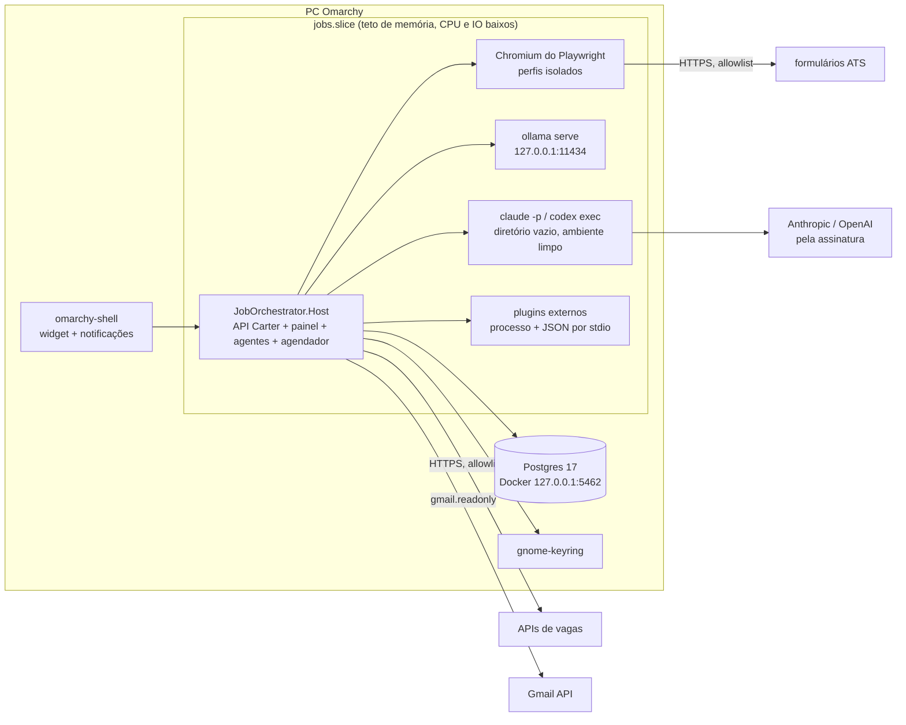

# Arquitetura

Complementa `docs/PLANO.md`. Data: 05/11/2026.

## 1. Processos



Monólito modular: um processo .NET com agentes como handlers de etapa. Navegador, CLIs de IA e plugins rodam como processos filhos isolados, então uma falha num deles não derruba o host.

## 2. Solução

```text
job-orchestrator/
  src/
    JobOrchestrator.Host/                 Program, DI, Carter, Features/ (vertical slices), Workers/ (agentes), Scheduling/, Health/
    JobOrchestrator.Domain/               entidades, value objects, grafo de estados, políticas, fingerprint, nota
    JobOrchestrator.Infrastructure/       EF Core + Npgsql, migrations, fila, leases, outbox, Secret Service, XDG, notificações
    JobOrchestrator.Adapters.Abstractions/  contratos versionados, manifests, CapabilityReport, token de envio
    JobOrchestrator.Adapters.Sources/     Greenhouse, Lever, Ashby, SmartRecruiters, GitHub, HN, agregadores
    JobOrchestrator.Adapters.Forms/       formulários Greenhouse, Lever, Ashby; agente genérico; Playwright
    JobOrchestrator.Adapters.External/    host de plugins por processo
    JobOrchestrator.Llm/                  LLMRouter, provedores, schemas, orçamento, cache
    JobOrchestrator.Resume/               seleção de fatos, composição, proveniência, templates, PDF
    JobOrchestrator.Tracking/             Gmail/IMAP, classificação, casamento, ICS, follow-ups
    JobOrchestrator.Cli/                  jo: doctor, status, campaign, submit-mode, llm bench, replay, export
  web/                                    Angular 22 no padrão do Grifo: projects/app (core + features por tela) e projects/ui (componentes)
  fake-ats/                               ASP.NET mínimo com os 10 cenários e contador de envios
  omarchy-plugin/                         widget da barra (manifest.json + BarWidget.qml)
  tests/  Unit/ Integration/ Contracts/ E2E/ Chaos/ Security/
  infra/  compose.yml  systemd/
  config/ campaign.example.yaml  appsettings.example.json
  scripts/ doctor.sh  bootstrap.sh  smoke-test.sh  night-sim.sh
  references/                             clones auditados, fora do git
```

As features da API são vertical slices com Carter, e o Domain concentra só o que tem invariante: estados, política de envio, identidade canônica e nota. Dados do usuário ficam fora do repo:
- `~/.local/share/job-orchestrator` para perfil, CVs, evidências e backups;
- `~/.config/job-orchestrator` para configuração;
- `~/.local/state/job-orchestrator` para logs;
- gnome-keyring para segredos.

## 3. Modelo de domínio

Campos comuns:
- `id` (UUIDv7), `created_at`, `updated_at`;
- `source`, `version` e `confidence` onde o dado pode envelhecer;
- `correlation_id` em tudo que pertence a uma candidatura.

| Grupo | Entidade | Campos principais |
|---|---|---|
| Perfil | CandidateProfile | versão, idiomas, status (rascunho, verificado), hash da versão |
| | VerifiedFact | tipo (experiência, skill, formação, certificação, idioma, conquista), enunciado, dados estruturados (empresa, cargo, início, fim, tecnologias), evidências, verificado em, sensível |
| | EvidenceSource | tipo (cv_pdf, linkedin_export, documento, declaração do dono), caminho, hash, importado em |
| | CareerStory | história STAR ligada a fatos |
| | AnswerTemplate | padrão da pergunta, embedding, resposta, escopo (ATS, empresa, idioma), sensibilidade (normal, sensível, legal), aprovada em, usos |
| | ConsentGrant | tipo (envio de rotina, outreach, leitura de e-mail, IA em nuvem), escopo (ATS, empresas, tipos, limite diário, janela), validade, versão da política, concedido por, revogado em |
| | WorkAuthorization | país, status (cidadão, autorizado, precisa de sponsor, não autorizado, desconhecido), evidência, confirmado em |
| Vagas | Campaign, CampaignSchedule | nome, ativa, fuso, janela, modo, limites, corte de nota |
| | SearchQuery | cargos, tecnologias, locais, senioridade, pisos por moeda e vínculo |
| | JobSource | tipo, configuração, permitida, `tos_checked_at`, rate limit, saúde |
| | Company | nome, domínios, boards de ATS, em vigilância |
| | JobPosting | campos canônicos: cargo, senioridade, stack, modalidade, país, fuso, salário, moeda, vínculo, sponsor, idiomas, link canônico, aberta até, última conferência |
| | JobSnapshot | hash do payload bruto, buscado em, campos extraídos, versão do parser |
| | CanonicalJobIdentity | fingerprint, componentes, primeira vez vista, contagem de reaberturas |
| Avaliação | EligibilityAssessment | regras avaliadas, passou ou falhou por regra, desconhecidos |
| | FitAssessment, ScoringBreakdown | nota 0–100, confiança, fator, peso, valor, evidência |
| | ApplicationMaterial, ResumeVersion | tipo, idioma, template, versão do perfil, snapshot da vaga, `resume_hash`, PDF, chamadas de modelo |
| | MaterialProvenance | material, bullet, fatos que sustentam |
| Execução | Application | perfil + identidade + campanha, estado, modo, resultado (trilha de acompanhamento) |
| | ApplicationAttempt, ExecutionStep | número, etapa, estado, adapter, hash de entrada e saída, seguro repetir |
| | AdapterExecution | adapter, versão, capability, resultado, duração, classe do erro |
| | WorkflowCheckpoint | estado semântico: campos preenchidos, fatos usados, anexos, URL, passo |
| | SubmissionIntent | candidatura, hash do payload, chave de idempotência, dono do lease, estado (aberta, enviada sem verificação, confirmada, descartada) |
| | ApplicationEvidence | nível, artefato, redação aplicada, hash |
| | HumanTask, ApprovalDecision | tipo (CAPTCHA, login, pergunta, aprovação, reconciliação), payload, prazo, decisão, hash do que foi aprovado |
| Adapters e IA | AdapterCapability, AdapterHealth, AdapterPerformance | ver §6; circuito, último canário, tentativas, confirmados, p50 e p95 por domínio |
| | ProviderQuota, ModelInvocation | provedor, janela, limites observados, reset estimado; tarefa, modelo, latência, cache, privacidade, schema válido |
| Acompanhamento | Outcome, RecruiterResponse, Contact | sinal (vista, recusa, teste, entrevista, oferta), origem, classificação, recrutador |
| | InterviewEvent, FollowUp | UID do ICS, início, fim, link; vencimento, rascunho, status |
| Auditoria | AuditEvent, Notification, DeadLetterItem | ator, ação, entidade, hashes antes e depois (append-only); destino, lida; etapa, erro, tentativas |

## 4. Invariantes e como são garantidas

| # | Invariante | Garantia | Teste |
|---|---|---|---|
| 1 | Sem submissão paralela da mesma pessoa, anúncio canônico, empresa, cargo e campanha | UNIQUE `(profile_id, canonical_job_id, campaign_id)`; `pg_advisory_xact_lock` pelo fingerprint ao abrir a intenção; UNIQUE parcial de intenção aberta por candidatura | dois workers disputando a mesma vaga |
| 2 | Só o Guardião libera envio | `SubmitToken` assinado (HMAC) pelo Guardião, ligado a intenção, hash do payload e validade; o Remetente recusa sem token; a transição para `SUBMITTING` exige decisão do Guardião gravada | chamada direta ao adapter sem token |
| 3 | Confirmado só com evidência forte | transição exige evidência L3, L4 ou L5 (§5) gravada antes, checada no domínio e por constraint | clique sem página de confirmação |
| 4 | Envio incerto nunca repete | o grafo não tem aresta de `SUBMISSION_UNKNOWN` para `READY_TO_SUBMIT` ou `SUBMITTING`; no boot, `SUBMITTING` sem recibo vira `SUBMISSION_UNKNOWN` | kill depois do clique |
| 5 | Regra legal e autorização vêm antes da nota | ordem fixa: legal, consentimento, elegibilidade, nota | vaga com nota 99 e país sem autorização |
| 6 | Nada inventado | cada bullet aponta para fatos; números, datas, cargos e tecnologias do bullet precisam existir nos fatos (checagem determinística) e passar pela revisão cruzada | fato plantado na saída do modelo |
| 7 | Adapter e modelo não mexem em política | políticas só mudam por endpoints do dono com confirmação; saída de modelo nunca é interpretada como configuração; adapters externos não têm acesso ao banco | instrução de injection pedindo para ligar o modo AUTO |
| 8 | Conteúdo externo é dado | delimitação no prompt, IA sem ferramentas, allowlist de URL, HTML sanitizado, sem shell | cenário 9 do Fake ATS |
| 9 | Id, correlationId e histórico append-only | trigger bloqueia UPDATE e DELETE em `audit.*` e `flow.execution_steps`; retenção por política e não por edição | tentativa de update |
| 10 | Envio automático desligado por padrão | instalação em `PREPARE_ONLY`; L3 só por `ConsentGrant` criado no painel; o arquivo de configuração não tem campo para isso | config tentando ligar |

Fingerprint: hash de empresa normalizada + cargo normalizado + id de requisição do ATS (ou URL canônica de candidatura sem parâmetros de rastreio) + faixa de local.

Dedup entre fontes:
- Exata: o link do agregador é resolvido até o ATS, então o mesmo id de vaga no ATS vira a mesma identidade.
- Aproximada: mesmo domínio de empresa, similaridade de cargo acima de 0,9 e datas próximas viram `DUPLICATE` com link.

Reabertura: uma vaga encerrada que volta com requisição nova, ou depois de 30 dias, ganha nova versão de identidade. Mesmo assim, o sistema não aplica de novo à mesma empresa e cargo em menos de 180 dias (configurável).

## 5. Máquina de estados

Fluxo principal:

`DISCOVERED → NORMALIZED → ELIGIBILITY_CHECKED → SCORED → SHORTLISTED → MATERIALS_READY → FORM_PREPARING → FORM_VALIDATED → (AWAITING_APPROVAL | READY_TO_SUBMIT) → SUBMITTING → (SUBMITTED_CONFIRMED | SUBMISSION_UNKNOWN | FAILED)`

Estados auxiliares:
- da spec: `REJECTED`, `SKIPPED`, `DUPLICATE`, `WITHDRAWN`, `EXPIRED`, `BLOCKED_BY_POLICY`, `NEEDS_HUMAN`, `PAUSED_QUOTA`, `PAUSED_PROVIDER`, `RETRY_SCHEDULED`, `DEAD_LETTER`;
- novos: `MANUAL_HANDOFF` (copiloto) e `SUBMITTED_DECLARED` (você marcou que enviou e ainda não há evidência).

| De | Para | Gatilho | Repetir é seguro? |
|---|---|---|---|
| DISCOVERED | NORMALIZED, DUPLICATE | normalização | sim |
| NORMALIZED | ELIGIBILITY_CHECKED, EXPIRED | conferência de abertura e filtros | sim |
| ELIGIBILITY_CHECKED | SCORED, REJECTED, BLOCKED_BY_POLICY | nota, filtro reprovado, Sentinela | sim |
| SCORED | SHORTLISTED, SKIPPED | corte e limites da campanha | sim |
| SHORTLISTED | MATERIALS_READY, PAUSED_PROVIDER, NEEDS_HUMAN | composição | sim (cache por hash) |
| MATERIALS_READY | FORM_PREPARING, MANUAL_HANDOFF | rota: adapter ou copiloto | sim |
| FORM_PREPARING | FORM_VALIDATED, NEEDS_HUMAN, RETRY_SCHEDULED, FAILED | preparo | sim, em contexto novo, antes do envio |
| FORM_VALIDATED | AWAITING_APPROVAL, READY_TO_SUBMIT, BLOCKED_BY_POLICY | Guardião (em `PREPARE_ONLY` a candidatura para aqui) | sim |
| AWAITING_APPROVAL | READY_TO_SUBMIT, WITHDRAWN | sua decisão sobre o payload exato | não se aplica |
| READY_TO_SUBMIT | SUBMITTING | Remetente com token | **não** |
| SUBMITTING | SUBMITTED_CONFIRMED, SUBMISSION_UNKNOWN, FAILED | resultado do clique; `FAILED` só com prova de que nada foi aceito (ex.: erro de validação exibido) | **não** |
| SUBMISSION_UNKNOWN | SUBMITTED_CONFIRMED, NEEDS_HUMAN, FAILED | reconciliação só de leitura (página, portal, e-mail) | leitura sim, envio nunca |
| MANUAL_HANDOFF | SUBMITTED_CONFIRMED, SUBMITTED_DECLARED, WITHDRAWN | e-mail casado ou marcação sua | não se aplica |
| NEEDS_HUMAN | estado seguro anterior, WITHDRAWN | tarefa resolvida | não se aplica |
| PAUSED_QUOTA, PAUSED_PROVIDER | estado anterior | reset ou provedor de volta | sim |
| RETRY_SCHEDULED | estado anterior, DEAD_LETTER | horário; `max_attempts` estourado | sim |

Etapas seguras para retry: leitura, normalização, elegibilidade, nota, geração de material (cacheada), preparo antes do envio, leituras de verificação, ingestão de e-mail.

Etapas que nunca repetem sozinhas:
- clique de envio;
- resposta a pergunta sensível ou legal;
- aceite de termos ou consentimento;
- envio de qualquer mensagem.

Níveis de evidência:

| Nível | Nome | Basta para confirmar? |
|---|---|---|
| L1 | `observed_form_filled` | não |
| L2 | `submit_action_executed` | não |
| L3 | `confirmation_page_observed` (padrão de confirmação do ATS reconhecido) | sim |
| L4 | `receipt_id_extracted` | sim |
| L5 | `confirmation_email_matched` (remetente do ATS, empresa e vaga casadas) | sim |

Trilha de resultado (separada do fluxo, só depois de enviada):
- `NONE`, `VIEWED`, `IN_PROCESS`, `ASSESSMENT`, `INTERVIEW`, `OFFER`, `HIRED`;
- `REJECTED_BY_COMPANY`, `NO_RESPONSE`, `WITHDRAWN_BY_CANDIDATE`.

## 6. Contratos dos adapters

```csharp
namespace JobOrchestrator.Adapters.Abstractions;

public enum Capability
{
    DiscoverJobs, CheckPostingOpen, ReadJob,
    ScoreFit, TailorResume, WriteCoverLetter, DraftAnswers,
    InspectForm, PrepareForm, ValidateForm, SubmitApplication,
    VerifySubmission, ReconcileSubmission, TrackOutcome
}

public enum AdapterResultKind
{
    Completed, Unsupported, RetryableFailure, PermanentFailure,
    NeedsHuman, BlockedByPolicy, QuotaExceeded, SubmissionUnknown
}

public enum BrowserMode { None, Headless, Headed }
public enum AdapterHosting { InProcess, ExternalProcess }

public sealed record AdapterManifest(
    string Id, string Version, string ContractVersion,
    AdapterHosting Hosting, IReadOnlyList<string> AllowedDomains, RiskLevel Risk);

public sealed record CapabilitySupport(
    Capability Capability,
    string DomainPattern,           // ex.: "job-boards.greenhouse.io"
    bool Declared,
    bool Tested,                    // passou no canário desta versão
    BrowserMode Mode,
    bool Reversible,
    bool RequiresApproval,
    double Confidence,              // 0..1, vem de resultados confirmados
    ResourceEstimate Cost);         // tempo, memória, chamadas de IA

public sealed record CapabilityReport(
    string AdapterId, string AdapterVersion,
    IReadOnlyList<CapabilitySupport> Supports,
    HealthStatus Health, DateTimeOffset ProbedAt,
    IReadOnlyList<string> Dependencies, IReadOnlyList<string> KnownBlockers);

public sealed record AdapterResult<T>(
    AdapterResultKind Kind, T? Value,
    string? ReasonCode, string? Detail,
    WorkflowCheckpoint? Checkpoint,
    IReadOnlyList<EvidenceRef> Evidence);

public interface IAdapter
{
    AdapterManifest Manifest { get; }
    Task<CapabilityReport> ProbeAsync(AdapterContext ctx, CancellationToken ct);
}

public interface IJobSourceConnector : IAdapter
{
    IAsyncEnumerable<RawPosting> DiscoverAsync(SourceQuery query, AdapterContext ctx, CancellationToken ct);
    Task<AdapterResult<PostingStatus>> CheckOpenAsync(CanonicalJobRef job, AdapterContext ctx, CancellationToken ct);
}

public interface IMaterialComposer : IAdapter
{
    Task<AdapterResult<MaterialDraft>> ComposeAsync(MaterialRequest request, AdapterContext ctx, CancellationToken ct);
}

public interface IFormAdapter : IAdapter
{
    Task<AdapterResult<FormPlan>> InspectAsync(ApplyTarget target, AdapterContext ctx, CancellationToken ct);
    Task<AdapterResult<FormCompletionReport>> PrepareAsync(FormPlan plan, MaterialBundle materials, AdapterContext ctx, CancellationToken ct);
    Task<AdapterResult<SubmissionReceipt>> SubmitAsync(SubmitToken token, AdapterContext ctx, CancellationToken ct);
    Task<AdapterResult<ReconciliationReport>> ReconcileAsync(SubmissionIntentRef intent, AdapterContext ctx, CancellationToken ct);
}

public interface IOutcomeTracker : IAdapter
{
    IAsyncEnumerable<OutcomeSignal> PollAsync(TrackingCursor cursor, AdapterContext ctx, CancellationToken ct);
}
```

O `AdapterContext` leva:
- correlation id, orçamento de tempo e lease do navegador;
- política já avaliada (só leitura);
- diretório de trabalho próprio;
- logger redigido.

O contexto nunca leva conexão de banco, segredo bruto ou permissão de mudar política.

Plugins externos (`Adapters.External`):
- O manifesto declara id, versão, contrato e capabilities.
- O host conversa com o plugin por JSON lines no stdio, com timeout por chamada.
- O plugin roda com ambiente limpo (sem `AWS_*`, `ANTHROPIC_API_KEY` ou `OPENAI_API_KEY`), `HOME` próprio e cwd isolado.
- Plugin externo só recebe `SubmitApplication` se estiver na allowlist do dono.

## 7. IA

Detalhe de UX, isolamento, cota e compatibilidade em `docs/integracao-ia.md`.

| Provedor | Autenticação | Chamada | Privacidade permitida |
|---|---|---|---|
| deterministic | nenhuma | no processo | todas |
| ollama | local | HTTP `127.0.0.1:11434`, `format` com JSON schema | todas |
| claude-cli | login da assinatura no CLI; uma instância por conta (`CLAUDE_CONFIG_DIR`) | `claude -p` | pública e perfil minimizado |
| codex-cli | login ChatGPT no CLI | `codex exec` | pública e perfil minimizado |
| gemini-cli | login Google no CLI (AI Pro) | `gemini -p -o json` | pública e perfil minimizado |
| paid-api | desligado | stub | nenhuma |

Execução do Claude:

```text
claude -p --output-format json --json-schema <schema> --model <haiku|sonnet>
       --tools "" --strict-mcp-config --no-session-persistence
       --system-prompt <regras fixas do orquestrador>
```

- Roda com cwd vazio em `~/.local/share/job-orchestrator/llm-sandbox/<id>`.
- O ambiente filho remove `ANTHROPIC_API_KEY`, `CLAUDE_CODE_USE_BEDROCK`, `CLAUDE_CODE_USE_VERTEX`, `AWS_*` e `OPENAI_API_KEY`.
- `--bare` é proibido: nesse modo o CLI só aceita API key.
- Sem ferramentas e sem MCP, a chamada é só texto, e uma injection na vaga não tem o que executar.

Execução do Codex:

```text
codex exec -m <modelo> --sandbox read-only --skip-git-repo-check --ephemeral
           --output-schema <schema.json> -o <saida.json>
```

O prompt vai pelo stdin, a validar na implementação.

Regras comuns aos provedores:
- **Prompt:** regras fixas no system prompt; vaga, página ou e-mail entram entre delimitadores marcados como não confiáveis; a saída é só JSON no schema.
- **Saída inválida:** uma nova tentativa com o erro do validador; se falhar de novo, a etapa falha.
- **Minimização:** o modelo recebe só os fatos selecionados para a vaga, sem nome, e-mail, telefone, endereço ou documentos. Placeholders são trocados na renderização.
- **Cota:** a saída e o código de erro são classificados por padrão ("usage limit", "rate limit", horário de reset, a calibrar na fase 3). O `ProviderQuota` fica em esgotado até o reset estimado, ou até 1 h de backoff se não houver estimativa.
- **Orçamento:** teto por noite, por provedor e por tarefa, com contadores persistidos.
- **Cache:** chave = hash(tarefa, provedor, modelo, versão do schema, entrada); fica guardado em Postgres com validade de 30 dias.

Catálogo de tarefas (padrões, todos configuráveis):

| Tarefa | Privacidade | Cadeia | Teto por noite |
|---|---|---|---|
| job.extract | pública | Ollama → regras | local |
| email.classify | privada | Ollama → regras (nunca nuvem) | local |
| fit.explain | pública + perfil minimizado | Ollama → Haiku | 40 |
| question.map | perfil minimizado | Ollama → Haiku | 40 |
| question.draft | perfil minimizado | Haiku → Codex → você | 30 |
| resume.tailor | perfil minimizado | Sonnet → Codex → Ollama (rascunho marcado) | 15 |
| resume.factcheck | perfil minimizado | Codex → Haiku | 15 |
| cover.write | perfil minimizado | Sonnet → Codex | 10 |
| form.remap | página redigida | Haiku → Codex → Ollama | 10 |
| interview.prep | perfil minimizado + vaga | Sonnet → Codex | 5 |
| digest.summarize | interna | Ollama | local |

Ollama:
- serviço de usuário com `OLLAMA_HOST=127.0.0.1:11434`, `OLLAMA_KEEP_ALIVE=5m`, `OLLAMA_MAX_LOADED_MODELS=1` e `OLLAMA_NUM_PARALLEL=1`;
- contexto padrão 8192;
- o modelo descarrega sozinho quando fica ocioso e devolve a VRAM ao desktop;
- os modelos são escolhidos por `jo llm bench`;
- de madrugada, CPU como fallback é aceitável em lote.

## 8. Navegador

- **Instalação e pool:** Playwright .NET com o Chromium baixado por `playwright install chromium`, sem `--with-deps`, que usa apt. Pool configurável: 2 contextos no total e 1 de envio. `BrowserContextLease` com TTL.
- **Perfis:** perfil dedicado por domínio de ATS em `~/.local/share/job-orchestrator/browser/`. O Chrome pessoal nunca é usado, e cookies nunca são copiados.
- **Modo:** headless por padrão, que funciona com a tela bloqueada. Headed só na sessão assistida: exige `WAYLAND_DISPLAY` e roda com `--ozone-platform=wayland`.
- **Preenchimento:** `getByRole` e `getByLabel`, mais reconhecedores por ATS. Esperas por condição, nunca sleep fixo. A página é relida antes de cada passo, sem handle antigo.
- **Estruturas:** `FieldMapping` (campo, rótulo, tipo, obrigatório, origem do valor), `FormCompletionReport`, `PageSnapshot` (árvore de acessibilidade + captura), `SubmitIntent` e `SubmissionReceipt`.
- **Redação:** e-mail, telefone e endereço são mascarados no DOM antes da captura, e o texto também é redigido.
- **Rede:** allowlist de domínios (ATS e domínios de carreira descobertos). IP privado, `file://` e redirecionamento para fora da lista são bloqueados. Downloads ficam desligados.
- **Upload:** só PDFs de `ResumeVersion` do diretório de materiais.
- **Sem disfarce:** nenhum stealth, fingerprint falso ou proxy.

## 9. Persistência e confiabilidade

- **Banco:** Postgres 17 (Docker, volume nomeado), EF Core 10 + Npgsql. Schemas `core`, `flow`, `crm` e `audit`.
- **Fila:** `flow.step_queue` com `run_after`, `lease_owner`, `lease_expires`, `attempts`, `max_attempts` e prioridade. Consumo com `FOR UPDATE SKIP LOCKED`, renovação de lease e recuperação de lease expirado.
- **Outbox:** eventos de domínio vão para a outbox e de lá para notificações e para o painel em tempo real (SSE).
- **Inbox:** ingestão de e-mail com UNIQUE no Message-ID.
- **DLQ:** etapas esgotadas vão para a DLQ, e o reprocessamento manual só é permitido nas etapas seguras.
- **Desligamento limpo:**
  1. para de pegar trabalho;
  2. dá até 30 s para as etapas em curso terminarem ou gravarem checkpoint;
  3. fecha os navegadores.
- **Boot:**
  - leases vencidos voltam para a fila;
  - `SUBMITTING` sem recibo vira `SUBMISSION_UNKNOWN`;
  - a reconciliação é agendada.
- **Backup:** `pg_dump -Fc` diário em `~/.local/share/job-orchestrator/backups`, com 14 cópias. `jo restore --verify` restaura num banco temporário e confere contagens. A pasta entra no restic.
- **Retenção:** snapshots de vaga por 90 dias, capturas por 30 dias; evidência minimizada fica enquanto a candidatura existir. Exportar e apagar tudo pelo painel.

## 10. Operação

Units de usuário (arquivos em `infra/systemd/`, instalados só com o seu ok):

```ini
# jobs.slice
[Slice]
MemoryHigh=3G
MemoryMax=4G
CPUWeight=20
IOWeight=20

# job-orchestrator.service
[Unit]
Description=Job Orchestrator
After=network-online.target
[Service]
Type=notify
Slice=jobs.slice
WorkingDirectory=%h/.local/share/job-orchestrator
EnvironmentFile=-%h/.config/job-orchestrator/env
ExecStart=%h/.local/share/job-orchestrator/bin/JobOrchestrator.Host
Restart=on-failure
RestartSec=10
TimeoutStopSec=60
NoNewPrivileges=yes
[Install]
WantedBy=default.target

# job-orchestrator-ollama.service
[Service]
Slice=jobs.slice
Environment=OLLAMA_HOST=127.0.0.1:11434 OLLAMA_KEEP_ALIVE=5m OLLAMA_MAX_LOADED_MODELS=1 OLLAMA_NUM_PARALLEL=1
ExecStart=/usr/bin/ollama serve
Restart=on-failure

# job-orchestrator-night.timer (22:45, sobe o serviço se estiver parado)
# job-orchestrator-backup.timer (diário)
```

- **Agenda:** a janela e o cronograma da campanha ficam no banco e são editáveis no painel. O agendador interno do host dispara a noite.
- **Uma noite por vez:** uma advisory lock de "execução de campanha" impede duas noites sobrepostas, mesmo com timer e reboot.
- **Noite padrão:**
  1. 22:50: canários;
  2. 23:00: descoberta, avaliação e materiais (Claude na ordem da nota);
  3. preparo;
  4. envios espaçados conforme o modo;
  5. verificação;
  6. 07:30: resumo;
  7. 08:00: encerra.
  O que não terminou continua na próxima janela.
- **Espaçamento:** limites por ATS e por empresa para não sobrecarregar ninguém. Não serve para esconder automação.

| Situação | Comportamento |
|---|---|
| Tela bloqueada | nada muda; headless segue |
| Sessão gráfica fechada | headless segue se o gerenciador de usuário estiver vivo; sessão assistida indisponível |
| Logout sem linger | o serviço para e retoma no próximo login, com recuperação |
| Suspensão | tudo pausa; ao voltar, os leases vencidos são recuperados e a janela é reavaliada |
| Reboot ou queda de energia | igual a crash: recuperação pelas regras do §9, sem repetir envio |
| Linger | desligado; ligar só se você quiser rodar sem login |

Comandos:

```text
jo doctor
jo status
jo campaign start|pause|resume|stop <nome>
jo submit-mode show
jo submit-mode revoke
systemctl --user start|stop|status job-orchestrator
journalctl --user -u job-orchestrator -f
```

## 11. Observabilidade

- **Logs:** Serilog em JSON para o journal e arquivos em `~/.local/state/job-orchestrator/logs`. Um enricher de redação cobre e-mail, telefone, CPF, tokens e os segredos conhecidos.
- **Eventos:** eventos de negócio ficam em `audit.events`, separados dos logs técnicos.
- **Traces e métricas:** OpenTelemetry, com exportador OTLP desligado por padrão (pode apontar para um painel local se você quiser).
- **Métricas:**
  - funil: descobertas, únicas, qualificadas, materiais, preparadas;
  - envio: tentadas, confirmadas, desconhecidas, bloqueadas;
  - tempo por etapa e erro por adapter e ATS;
  - chamadas e cota por provedor;
  - taxa de resposta posterior.
- **Execuções:** linha do tempo por noite, com replay só das fases reversíveis.

## 12. Configuração

Esquema tipado (options do .NET com validação e JSON Schema gerado). Exemplo:

```yaml
candidate:
  profile_path: "${XDG_DATA_HOME}/job-orchestrator/profile_truth.md"
  data_mode: local_first

campaigns:
  - name: "Backend e Software Engineering"
    enabled: false
    timezone: America/Sao_Paulo
    window: "23:00-08:00"
    desired_roles: ["Backend Engineer .NET", "Software Engineer", "Full Stack .NET React"]
    technologies: ["C#", ".NET", "ASP.NET Core", "AWS", "PostgreSQL"]
    locations: ["Brazil", "Remote worldwide accepting Brazil"]
    min_fit_score: 85
    max_submissions_per_day: 15
    max_per_company_days: 180
    sources: []                 # preenchido pela tela de fontes
    allow_external_outreach: false
    # modo de envio NÃO existe aqui: só ConsentGrant criado no painel

execution:
  max_browser_contexts: 2
  max_concurrent_submissions: 1
  max_retries_per_safe_step: 2
  paid_api_budget: 0
  prefer_local_processing: true
  fallback_policy: capability_based
  router_weights: { success: 0.35, compat: 0.15, risk: 0.15, health: 0.15, latency: 0.10, quota: 0.10 }

providers:
  ollama:      { enabled: true,  model: auto_benchmarked }
  claude_code: { enabled: false, auth: subscription_cli_only, nightly_budget: { resume.tailor: 15 } }
  codex_cli:   { enabled: false, auth: chatgpt_cli_only }
  paid_apis:   { enabled: false }

tracking:
  gmail: { enabled: false, method: api_readonly, no_response_after_days: 21 }
```

O exemplo não liga envio, não liga provedor em nuvem e não informa cota. Cota desconhecida aparece como `unknown`.

## 13. Decisões

| ADR | Decisão |
|---|---|
| 0001 | Motor de fluxo: máquina de estados própria em Postgres, sem Temporal (`docs/adr/0001-motor-de-fluxo.md`) |
| 0002 | Monólito modular .NET 10 com Carter e vertical slices; processos filhos para navegador, IA e plugins |
| 0003 | Playwright .NET no lugar de sidecar Node |
| 0004 | Painel em Angular 22 (mesma arquitetura do frontend do Grifo), servido pela própria API; sem servidor Node em runtime |
| 0005 | IA só local ou pelos CLIs oficiais das assinaturas; API paga desligada; nunca `claude --bare` |
| 0006 | Os cinco repos auditados ficam como referência; integração futura só como plugin de processo |
| 0007 | PDF pelo Chromium a partir de HTML, validado com poppler; sem LaTeX |
| 0008 | Acompanhamento por Gmail `gmail.readonly`; IMAP como alternativa |
| 0009 | Sem Redis no início; Postgres é a fonte da verdade e a fila |
| 0010 | Segredos no Secret Service (gnome-keyring); consentimento só pelo painel, nunca por arquivo |
| 0011 | Canvas do fluxo próprio em SVG (zoom, arrasto, minimapa), sem biblioteca; topologia de segurança fixa; stack-diagram só como referência |
| 0012 | Modelo e esforço na medida: começa no degrau mínimo calibrado por tarefa e só sobe quando a validação falha (`docs/integracao-ia.md` §10) |
