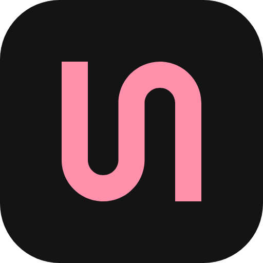

# Identidade do Job Orchestrator

## Marca

A marca é **a rota**: um caminho só, que desce, faz a curva, sobe e desce de novo. É o que o sistema faz com cada vaga: leva da fonte à triagem, dos materiais ao formulário e do envio ao acompanhamento, sem atalho e sem voltar atrás. As curvas são as mesmas dos conectores do canvas de fluxo, então a marca e a tela falam a mesma língua.

- **Origem:** forma 57 do [shapes.gallery](https://www.shapes.gallery/), de Monika Michalczyk, oferecida livre para projetos. Usada como veio, sem redesenho. Crédito em `web/projects/app/public/icons/NOTICE.txt`.
- **Construção:** grade de 256, traço de 48 (18,75% da largura), curvas de raio 76 por fora e 28 por dentro. A forma ocupa a grade inteira.

## Cores

| Token | Escuro | Claro | Uso |
|---|---|---|---|
| `--accent` (rosa da marca) | `oklch(78% 0.136 5)`, #ff90ac | `oklch(59% 0.161 5)`, #c84b70 | marca, ação principal, item ativo |
| grafite | `oklch(19% 0 0)`, #141414 | `oklch(97.5% 0 0)` | fundo do painel e do ícone do app |
| neutros | sem matiz (`oklch(L 0 0)`) | sem matiz | superfícies, texto, bordas |

O rosa aparece pouco: na marca, no botão principal e no item ativo. O resto da tela é neutro, para o status (ok, atenção, erro) ser a cor que chama o olho.

## Ícone do app

Quadrado grafite com raio de 58/256 e a marca em rosa com margem de 60/256. Arquivos: `brand/app-icon.svg`, `brand/app-icon-512.png` e `web/projects/app/public/favicon.svg`.

## Tipografia

- **Inter Variable:** interface e textos.
- **JetBrains Mono:** dados, números, rótulos das arestas do canvas e trechos de evidência.

## Regras de uso

- Tamanho mínimo de 16 px. Respiro em volta de pelo menos 1/4 da altura da marca.
- Uma cor por vez: rosa sobre grafite, grafite sobre claro, ou a cor do texto ao redor (componente `jo-mark`).
- Nunca girar, espelhar, contornar, aplicar gradiente ou sombra.
- A marca fica na barra lateral, no ícone do app e nos documentos. Não vira ornamento em tela vazia, título ou cartão.

## Tom

Português direto, sem emoji e sem travessão. Status com substantivo e número ("8 vagas", "4 na fila"). O sistema diz o que fez e o que precisa de você, sem prometer nem dramatizar.
